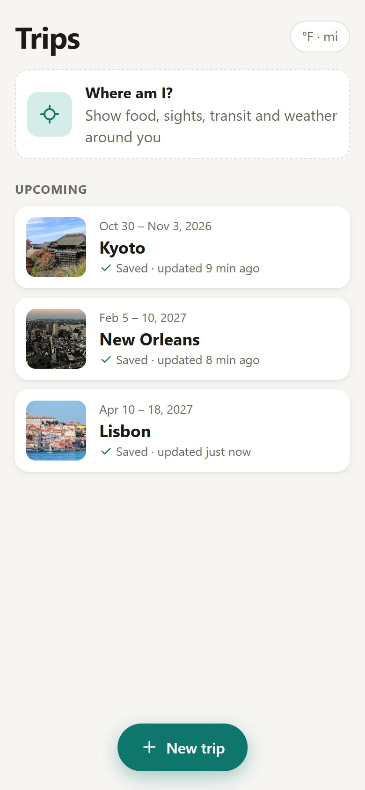
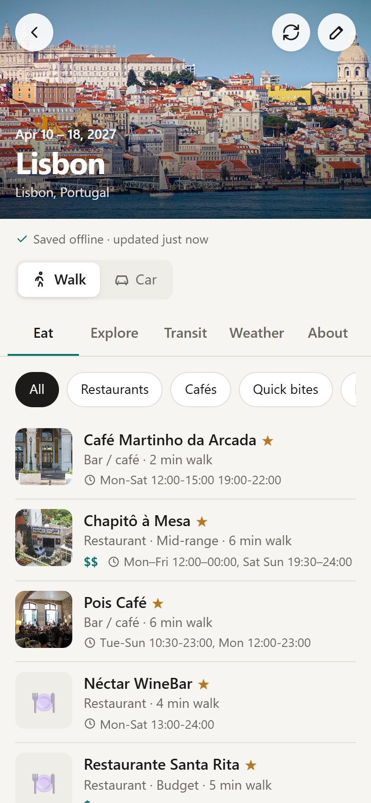
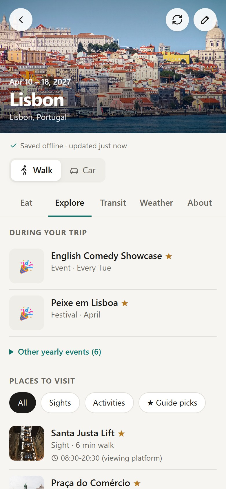
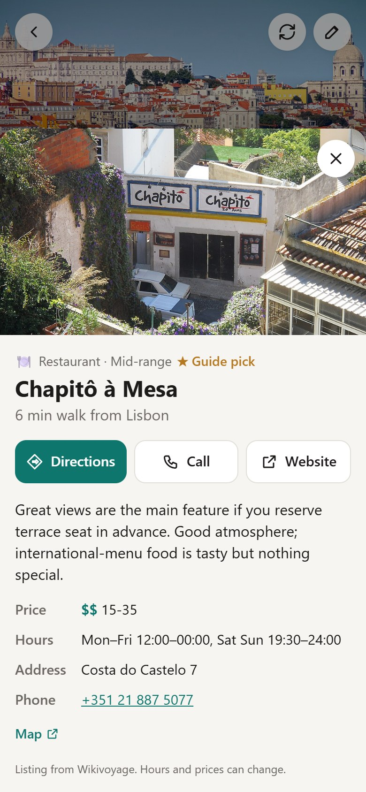
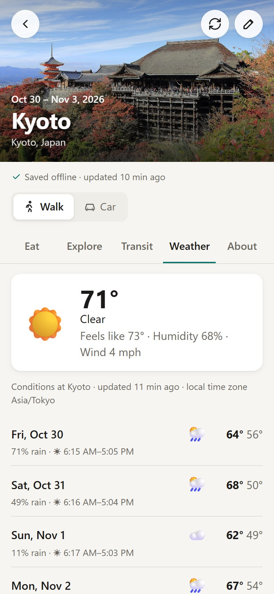
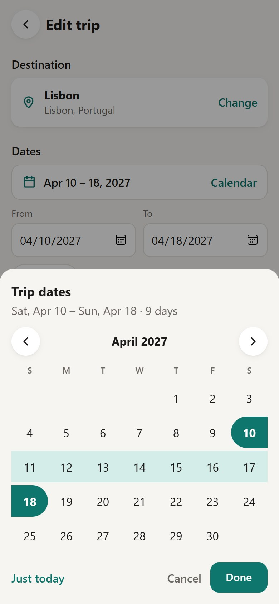

# Travel Companion

An offline travel guide for your phone. Add a trip, and it saves where to eat,
what to see, how to get around, events during your dates, and the weather, so it
all works with no signal.

**Open the app:** https://tony-hagerty.github.io/offline-travel-companion/

<table>
  <tr>
    <td></td>
    <td></td>
    <td></td>
  </tr>
  <tr>
    <td align="center">Your trips</td>
    <td align="center">Where to eat</td>
    <td align="center">Events and sights</td>
  </tr>
  <tr>
    <td></td>
    <td></td>
    <td></td>
  </tr>
  <tr>
    <td align="center">Details and directions</td>
    <td align="center">Weather for your dates</td>
    <td align="center">Pick dates in one step</td>
  </tr>
</table>

## Features

- **Trips** — search for a destination, or tap **Where am I?** for what's around you right now.
- **Eat · Explore · Transit · Weather · About** tabs for every trip.
- **Events** — Explore shows festivals and regular events that fall during your dates.
- **Details** — hours, prices, address, phone, website, and one-tap directions in Apple Maps or Google Maps.
- **Walk or Car** — about a 30-minute walk or a 20–30 minute drive. Both are saved separately.
- **Works offline** — trips, listings, and photos are saved on the phone.
- **Updates only when you ask** — tap the refresh button. Nothing changes behind your back.
- **Dates your way** — a calendar popup, separate From/To boxes, or "Just today".

## Install on your phone

It's a web app (PWA), so there's no app store. Open the link above, then:

- **iPhone (Safari):** Share button → **Add to Home Screen**.
- **Android (Chrome):** ⋮ menu → **Install app**.
- **Android (Brave):** ⋮ menu → scroll down → **Add to Home screen**.

Open each trip once while online so it downloads; after that it works offline.

## Where the data comes from

Everything is free and needs no API keys.

| What | Source |
|---|---|
| Places, hours, cuisines, stations | [OpenStreetMap](https://www.openstreetmap.org/copyright) via Photon, Nominatim, and Overpass |
| Travel picks, prices, events | [Wikivoyage](https://www.wikivoyage.org/) |
| Photos and descriptions | [Wikipedia](https://www.wikipedia.org/) and [Wikimedia Commons](https://commons.wikimedia.org/) |
| Weather | [Open-Meteo](https://open-meteo.com/) |

Map data © OpenStreetMap contributors (ODbL). Wikivoyage and Wikipedia text is
CC BY-SA; photos keep their own Commons licenses. Free data is thinner in small
towns, and there are no star ratings.

## Development

Needs Node 24.

```bash
npm install
```

```bash
npm run dev
```

| Command | What it does |
|---|---|
| `npm run dev` | Local dev server at http://127.0.0.1:5173 |
| `npm test` | Unit tests (Vitest) |
| `npm run build` | Type-check and build to `dist/` |
| `npm run preview` | Serve the build at http://127.0.0.1:4173 |
| `npm run icons` | Regenerate the app icons |

**Test on an Android phone over USB** (no hosting needed): run `npm run build`
and `npm run preview`, then forward the port and open `http://localhost:4173` on the phone:

```bash
adb reverse tcp:4173 tcp:4173
```

**Deploy:** every push to `master` runs the tests, builds, and publishes to
GitHub Pages (see [.github/workflows/deploy.yml](.github/workflows/deploy.yml)).

See [PLAN.md](PLAN.md) for design decisions and the roadmap.
